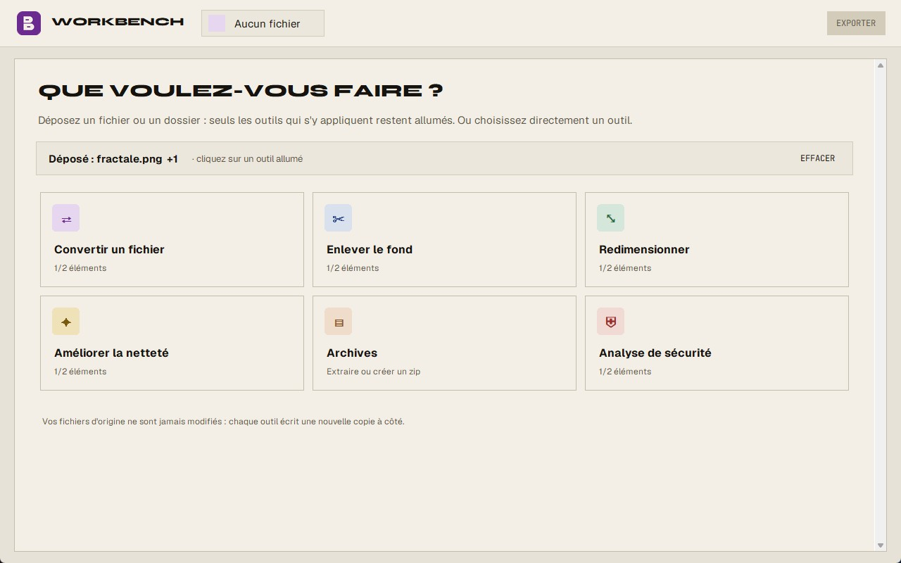

# Workbench

Application de bureau pour convertir, détourer, redimensionner et améliorer des images,
des vidéos et des sons, extraire ou créer des archives zip et vérifier un dossier avec Windows Defender.
100 % Python, interface Tkinter, moteur ffmpeg + Pillow.

Anciennement « ITools / Studio Multimédia » (renommée le 19/09/2026, dossier compris).



## Télécharger

**[Workbench pour Windows (.zip)](https://github.com/Pierre-Dunand-Chatellet/Workbench/releases/latest/download/Workbench-windows.zip)**
— dézipper, puis lancer `Workbench.exe`. ffmpeg est inclus : rien d'autre à installer. Le modèle
de détourage (176 Mo) se télécharge au premier détourage. Windows peut afficher « Windows a
protégé votre ordinateur » (exécutable non signé) : *Informations complémentaires → Exécuter
quand même*.

Le zip contient ffmpeg et ffprobe (build « full » de [gyan.dev](https://www.gyan.dev/ffmpeg/builds/)),
sous licence GPL v3 : texte joint dans `ffmpeg\LICENSE.txt`, sources sur
[ffmpeg.org](https://ffmpeg.org/download.html) et [github.com/FFmpeg/FFmpeg](https://github.com/FFmpeg/FFmpeg).

## Lancer depuis les sources

```
cd src
pip install -r requirements.txt
python Workbench.py
```

## Ce qu'il faut sur la machine

| | |
|---|---|
| Python | 3.11 ou plus |
| Paquets | `pip install -r src/requirements.txt` |
| **ffmpeg** | dans le `PATH` pour lancer depuis les sources — **pas un paquet pip**. Le `.exe`, lui, l'embarque |
| Windows Defender | facultatif : sans lui, l'analyse de sécurité ne fait que sa partie locale |

Sans ffmpeg, les images continuent de marcher (Pillow), mais la vidéo et le son sont morts.
Vérification : `ffmpeg -version`.

`Workbench.py` se relance tout seul sur un autre interpréteur si celui qui le lance n'a pas
Pillow et tkinterdnd2 (VS Code prend parfois un Python tout neuf).

## Les six outils

| Outil | Moteur | Remarques |
|---|---|---|
| Convertir | ffmpeg | image / vidéo / son. Les cibles proposées dépendent de la source : un GIF animé peut partir en mp4, une vidéo muette ne propose pas mp3 |
| Enlever le fond | u2net via onnxruntime | 176 Mo téléchargés au premier usage, une seule fois |
| Redimensionner | Pillow (image) · ffmpeg (vidéo, GIF animé) | Pillow donne la taille exacte ; les formats vidéo sont arrondis au pixel pair (contrainte yuv420p) |
| Améliorer la netteté | Pillow | agrandissement Lanczos + masque flou. **Pas** un upscale IA. Images fixes uniquement |
| Archives | `zipfile` (bibliothèque standard) | liste le contenu d'un .zip, extrait tout ou la sélection, envoie les médias vers Convertir ; crée un zip à partir de fichiers et dossiers (jamais d'écrasement, annulable) |
| Analyse de sécurité | Windows Defender (`MpCmdRun.exe`) + signaux locaux | ne supprime, ne déplace, ne met en quarantaine **rien** |

Les originaux ne sont jamais modifiés : chaque outil écrit un nouveau fichier à côté.

### Un zip déposé dans n'importe quel outil

Ses images, vidéos et sons (les extensions de `convert.FORMATS`) sont extraits dans
`%TEMP%\workbench_zip\<nom>_<hash>\` puis ajoutés à la liste. Les résultats ne sont **pas**
écrits dans ce dossier temporaire (effacé à la fermeture) mais dans
`<dossier du zip>\<nom du zip>_workbench\`.

### Garde-fous des archives (`archives.py`)

- chemins absolus, lecteurs (`C:`), `..`, `:` (flux NTFS), noms réservés (`CON`, `NUL`…)
  refusés et signalés ; le chemin résolu doit rester dans la destination (« zip slip ») ;
- 4 Go décompressés et 10 000 éléments au plus (bombe zip), avec un recomptage des octets
  réellement écrits ;
- membres chiffrés ignorés et signalés ; membres endommagés signalés, les autres sortent ;
- jamais d'écrasement : `nom (1).ext`, comme les autres outils.

### Analyse de sécurité (`securite.py`)

1. **Windows Defender** : `MpCmdRun.exe -Scan -ScanType 3 -File <dossier> -DisableRemediation`
   (le plus récent de `ProgramData\Microsoft\Windows Defender\Platform\`, sinon celui de
   `Program Files`). Code 0 = rien, 2 = menaces (lignes `Threat` lues), autre code ou exe
   absent = « Defender indisponible, seule l'analyse locale a été faite ».
2. **Signaux locaux** (heuristiques, lecture des 4 premiers Ko seulement, liens et jonctions
   non suivis) : extension exécutable ou script → *À vérifier* ; double extension
   (`facture.pdf.exe`), caractère RLO, programme Windows (en-tête MZ/PE) sous une extension
   non exécutable → *Suspect* ; Office avec macros, zip contenant des programmes → *À vérifier*.

Les signaux locaux sont des indices, **pas un antivirus**. Defender peut exiger que sa
protection soit active (il répond sinon par un code d'erreur : « indisponible »).

## Le modèle de détourage

`u2net.onnx`, 176 Mo, cherché dans `%USERPROFILE%\.u2net\` puis `%USERPROFILE%\.rembg\models\u2net\`
(`U2NET_HOME` surcharge le premier). Téléchargé au premier détourage, avec un pourcentage
affiché — jamais au démarrage sans qu'on l'ait demandé.

On parle directement à onnxruntime : `import rembg` tirait 1208 modules
(pymatting → numba → scipy) inutiles ici, soit ~13 s au lancement. Le masque est identique
au pixel près.

## Tests

À lancer depuis `src\` :

```
python test_convert.py      # moteur : conversions réelles, qualité, GIF animé, annulation, délais
python test_archives.py     # zip : zip slip, plafonds, médias seuls, écrasement, zip corrompu, création
python test_securite.py     # chaque signal local, Defender absent / simulé / réel (dossier sain)
python test_workbench.py    # interface : saisie, aperçus, file d'attente, zip déposé, 6 outils
python Workbench.py --smoke # vérifie un build : écrit %TEMP%\workbench_smoke.txt
```

`test_convert` et `test_workbench` ont besoin de ffmpeg. Aucun test ne crée de fichier
malveillant ni le fichier EICAR : les signaux sont simulés avec des fichiers anodins renommés,
et la sortie « menaces » de Defender avec un faux `MpCmdRun` (.bat qui imite sa sortie).
Tout s'exécute sans framework : `assert` et `python fichier.py`.

## Construire le .exe

Depuis `src\` :

```powershell
pip install pyinstaller
.\build.ps1              # construit ..\dist\Workbench\Workbench.exe, nettoie, vérifie (--smoke)
.\build.ps1 -SansTest    # construit seulement
```

Le script exclut ce dont l'application n'a pas besoin. Sans ces exclusions le build passe de
**106 Mo à 252 Mo** : le hook `onnxruntime` déclare `onnxruntime.transformers` et
`onnxruntime.tools` en imports cachés, qui traînent numba → **llvmlite (115 Mo)** et scipy —
exactement la chaîne qu'on évite en n'important pas `rembg`. Il retire aussi la base de
fuseaux horaires de Tcl (77 Mo), que Tkinter ne lit jamais.

Le `.exe` **embarque ffmpeg et ffprobe** (build « full » de gyan.dev, copié depuis cette
machine par `build.ps1`, ~445 Mo, licence GPL jointe) dans `dist\Workbench\ffmpeg\` : rien à
installer sur la machine cible, et c'est toujours ce ffmpeg-là que le `.exe` utilise. Le
**modèle** n'est pas embarqué : il se télécharge au premier détourage. Le build livre aussi
`dist\Workbench\fonts\` (Syne, Geist, JetBrains Mono) : `--smoke` vérifie qu'elles sont chargées.
Un raccourci
`Workbench.lnk` du menu Démarrer pointe sur `dist\Workbench\Workbench.exe`.

## Interface

L'appli s'ouvre sur l'**accueil** : une zone de dépôt et la grille des six outils. Ce qu'on
dépose grise les outils qui ne s'y appliquent pas (avec la raison) ; un clic sur une tuile
allumée ouvre l'outil avec ce qui le concerne. Pas de barre latérale : le logo et
« ‹ Tous les outils » ramènent à l'accueil.

Palette (même famille que le portfolio, version claire) : fond « papier » `#E7E2D7`, carte
`#F3EFE6`, texte « encre » `#16130F`, ligne `#C4BDAC`, accent aubergine `#6B2A8F`. Polices :
Syne ExtraBold pour les titres (en capitales, jamais sur des chiffres : son « 1 » ressemble à un
« I »), Geist pour le texte, JetBrains Mono pour les boutons, les tailles et les chemins. Elles sont
livrées dans `src\fonts\` (licence SIL OFL, texte dans `LICENCES.txt`), copiées à côté du `.exe` par
`build.ps1` et enregistrées au démarrage pour le seul processus (`AddFontResourceExW` : rien n'est
installé sur la machine). Sans elles, l'appli retombe sur Segoe UI et Consolas. Teintes des outils :
Convertir aubergine, Enlever le fond bleu encre, Redimensionner vert, Netteté ocre, Archives
pêche/brun, Sécurité rouge doux. Logo : un B fait de deux tiroirs (pastille aubergine, tiroirs
crème), `logo.svg` et `image_logo()` (même dessin) ; `build.ps1` en tire `logo.ico` pour le `.exe`.

Choix assumés :
- pas de **PDF** en sortie de conversion — cela demanderait une dépendance de plus ;
- pas d'historique annuler / rétablir. Le bouton « Annuler » pendant un traitement existe ;
- les listes (Archives, Sécurité) sont des `ttk.Treeview` : la gravité colore la ligne
  entière au lieu d'une pastille, un Treeview ne sait pas dessiner dans une seule cellule.

## Organisation

```
Workbench\
  README.md
  src\                   les sources
    Workbench.py         interface Tkinter, les six panneaux
    convert.py           moteur : ffmpeg, Pillow, u2net. Aucune dépendance à Tk
    archives.py          zip : lister, extraire, extraire les médias, créer, garde-fous
    securite.py          Windows Defender + signaux locaux
    test_convert.py      tests du moteur
    test_archives.py     tests des archives
    test_securite.py     tests de l'analyse de sécurité
    test_workbench.py    tests de l'interface
    build.ps1            construction du .exe (source de vérité, pas le .spec)
    logo.svg             le logo en vectoriel
    fonts\               Syne, Geist, JetBrains Mono (.ttf statiques) et LICENCES.txt (SIL OFL)
    requirements.txt
  dist\Workbench\        sortie PyInstaller — régénérable, ne pas versionner
```

`build/`, `*.spec` et `__pycache__` sont supprimés par `build.ps1` : rien à garder.
